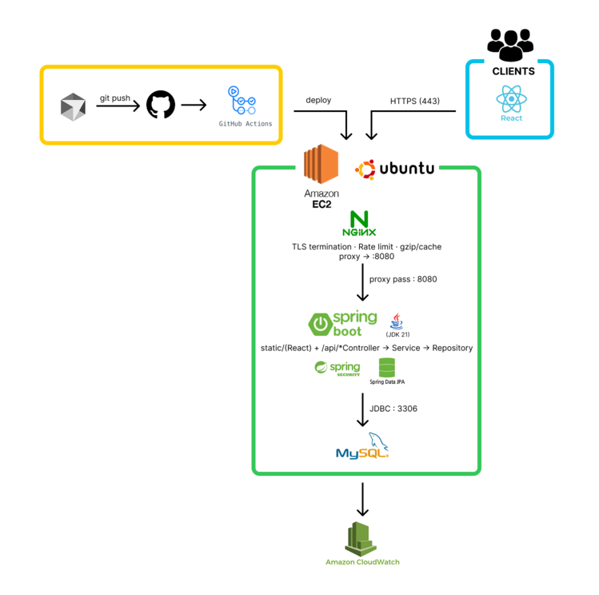
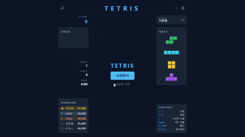
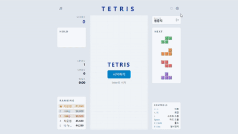
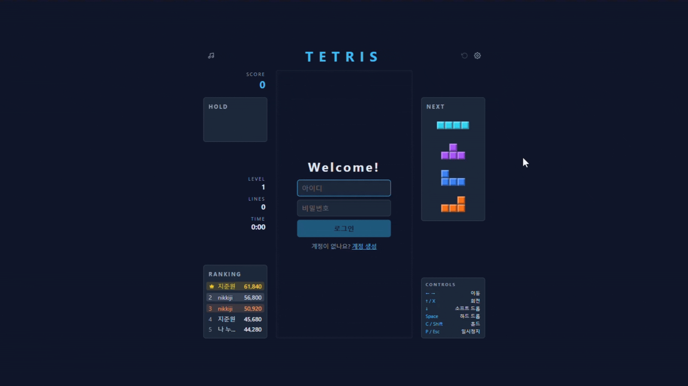
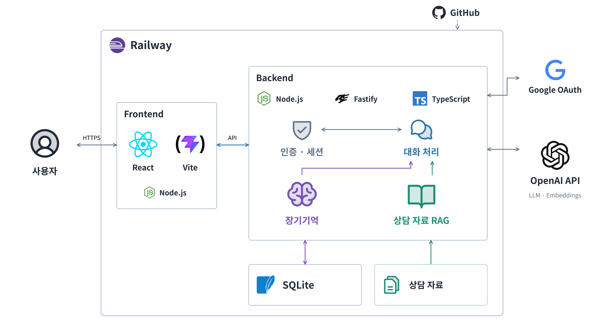
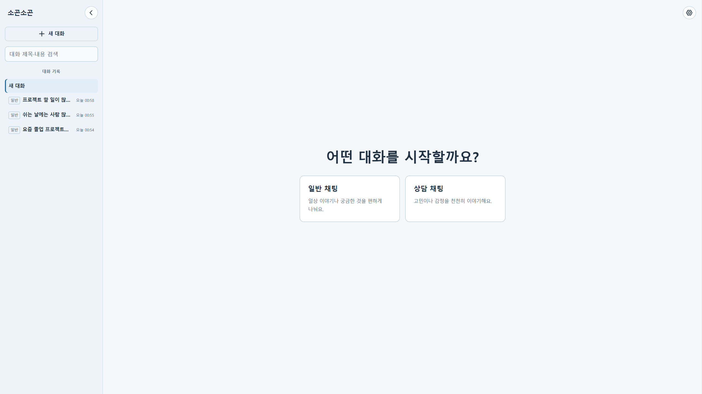
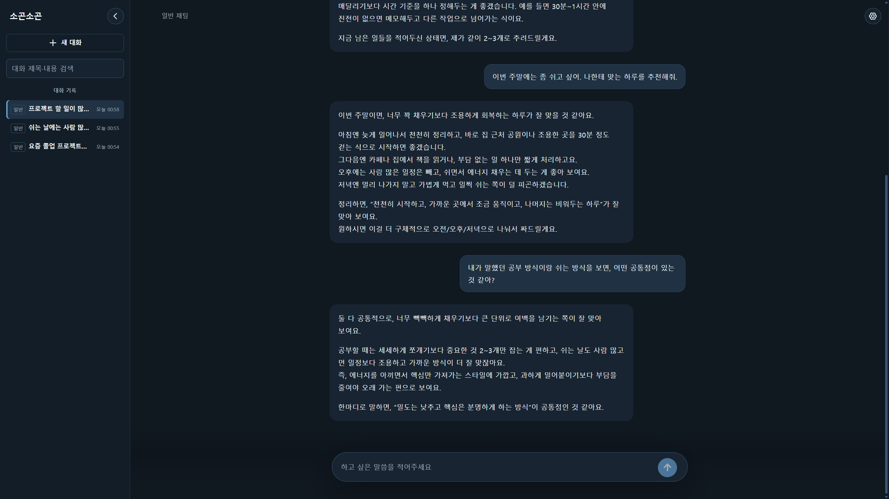

**지준원**  
만 24세 (2002.07.18) · 상명대학교 휴먼AI공학전공  
✉️ jijunwon02@gmail.com · 💻 [GitHub](https://github.com/jijunwon)

> 기능이 동작하는 것과 안전하게 동작하는 것은 다르다고 생각합니다.

저는 Java를 주로 다루는 백엔드 개발자입니다. 
정보처리기사를 준비하며 C, Java, Python, SQL 등 여러 언어의 문법과 동작 원리를 익혔고, 데이터베이스, 운영체제, 네트워크 같은 CS 기초도 함께 다졌습니다. 
백엔드와 프론트엔드를 모두 살펴보며 화면에서 요청이 들어와 서버와 DB를 거쳐 응답이 돌아가는 전체 흐름을 이해하려고 했습니다. 
그 과정에서 기능이 늘어나도 서비스 구조가 흔들리지 않도록 설계하는 일이 가장 중요하다고 느꼈고, 그런 탄탄한 뒷단을 만드는 백엔드 개발자가 되고 싶습니다.

<br clear="all" />

---

## 기술 스택

| 구분 | 스택 |
|---|---|
| Backend | Java 21, Spring Boot, Spring Security, JPA, Node.js(TypeScript, Fastify) |
| Frontend | React, JavaScript, Vite |
| Database | MySQL, SQLite |
| Infra | AWS EC2(Ubuntu), Nginx, Let's Encrypt, CloudWatch |
| DevOps | Git, GitHub Actions |
| Test / Tools | k6, Cursor |

---

## 프로젝트

| 프로젝트 | 핵심 | 기간 | 인원 |
|---|---|---|---|
| [테트리스 웹 서비스](#1-테트리스-웹-서비스) | 인증·랭킹 API, 트래픽 제어, 배포 자동화 | 2026.10 ~ 11 | 1명 |
| [AI 상담 에이전트](#2-ai-상담-에이전트) | 장기기억·RAG, 데이터 접근 범위 분리 | 2025.12 ~ 2026.11 | 5명 |

<br>

# 1. 테트리스 웹 서비스

프론트엔드와 백엔드 사이의 데이터 흐름을 직접 설계해보기 위해 제작한 웹 게임 서비스입니다.
회원 인증과 점수 랭킹 기능을 구현하고, 부하 테스트와 트래픽 제어,
배포 자동화와 모니터링까지 운영 환경 전반을 단독으로 구성했습니다.

🔗 [배포 링크](https://jijunwon-tetris.duckdns.org/) · 💻 [GitHub](https://github.com/jijunwon/Tetris) · 📅 2026.10 ~ 11 · 👤 개인 프로젝트

## 아키텍처



```
Clients ──HTTPS:443──▶ Nginx ──proxy_pass:8080──▶ Spring Boot ──JDBC:3306──▶ MySQL
                     (EC2 / Ubuntu)
```

- **Nginx** — HTTPS 종료, Rate Limit, gzip·정적 파일 캐시 헤더, 리버스 프록시
- **Spring Boot** — React 빌드 결과물과 API를 같은 주소에서 제공, Controller / Service / Repository 계층 분리, Security(세션), JPA
- **GitHub Actions** — main 브랜치 통합 시 자동 빌드·배포
- **CloudWatch** — 서버 지표 수집 및 경보


## 기술 선택 이유

| 기술 | 선택 이유 |
|---|---|
| Spring Boot | 계층 분리와 보안 설정을 표준적인 방식으로 구성하기 위해 |
| Spring Security (세션) | 단일 서버 환경이라 서버 측에서 세션을 즉시 무효화할 수 있음 |
| BCrypt | 솔트가 내장되고 연산 비용을 조절할 수 있어 비밀번호 저장에 적합 |
| Nginx | 애플리케이션에 요청이 도달하기 전, 앞단에서 트래픽을 제어하기 위해 |
| k6 | 시나리오를 스크립트로 작성해 동일 조건으로 반복 검증이 가능 |

## 주요 기능

| 기능 | 구현 내용 |
|---|---|
| 회원가입 | 중복 아이디 검증, BCrypt 해싱 후 저장, 성공 시 `201` / 중복 시 `409` |
| 로그인 | Spring Security 세션 기반 인증, 실패 시 `401` |
| 점수 저장 | 게임 종료 시 사용자별 기록 저장 |
| 랭킹 조회 | 상위 N명 조회 (기본 10명) |

## 데모

#### 플레이



#### 테마



#### 계정 생성 및 로그인



## API 설계

JSON 기반 RESTful API로 통신하며, HTTP 메서드와 상태 코드로 요청·응답을 구분했습니다.

| Method | Endpoint | 설명 | 응답 |
|---|---|---|---|
| POST | `/api/auth/signup` | 회원가입 | 201, 400, 409 |
| POST | `/api/auth/login` | 로그인 | 200, 401 |
| GET | `/api/auth/me` | 로그인 사용자 조회 | 200, 401 |
| POST | `/api/scores` | 점수 저장 | 201, 401 |
| GET | `/api/scores/top?limit=N` | 상위 N명 랭킹 조회 (기본 10) | 200 |

<br>

## 트러블슈팅 1 — 운영 중인 데이터를 유지하며 스키마 변경하기

### 문제

개발 초기에 회원 정보를 아이디와 비밀번호로만 구성했습니다.
이후 랭킹 기능을 구현하는 과정에서 아이디를 그대로 노출할 수 없다는 점을 확인했고,
닉네임 컬럼이 필요하다는 것을 뒤늦게 알게 되었습니다.

이미 배포된 상태라 사용자들의 점수 기록이 쌓여 있었고,
테이블을 새로 만들면 기존 데이터를 모두 잃는 상황이었습니다.
또한 랭킹에서 사용자를 구분하려면 닉네임이 중복되면 안 되었는데,
기존 계정에는 닉네임 값이 없어 바로 unique 조건을 걸 수 없었습니다.

### 원인

저장할 데이터를 정의하는 단계에서 화면에 무엇이 표시될지까지 고려하지 않았습니다.
기능 단위로만 생각하고 데이터 모델을 설계한 것이 원인이었습니다.

### 해결

기존 데이터를 유지한 채 구조를 변경해야 했으므로 아래 방식을 검토했습니다.

| 방안 | 검토 결과 |
|---|---|
| 테이블 재생성 | 기존 점수 기록이 모두 사라져 제외 |
| NOT NULL 컬럼 즉시 추가 | 기존 행에 값이 없어 제약 조건 위반 |
| nullable 컬럼 추가 후 값 채우기 | 기존 데이터 유지 가능, 선택 |

두 단계로 나누어 적용했습니다.

1. **컬럼 추가** — 닉네임 컬럼을 nullable로 추가하고,
   닉네임이 없는 기존 계정은 화면에 아이디를 대신 표시해 서비스가 끊기지 않도록 했습니다.
2. **기존 데이터 정리** — 닉네임 중복 금지(unique)를 적용하기 전에 SQL 스크립트로 빈 값을 채웠습니다.
   - 닉네임이 없는 계정 4개에 아이디(최대 12자)를 닉네임으로 부여
   - 그 값과 같은 닉네임을 이미 쓰던 계정 1개는 점수 기록과 함께 삭제

운영 DB를 직접 수정하는 작업이라 다음 안전장치를 두었습니다.

- 실행 전 `mysqldump`로 전체 백업
- 로컬 MySQL에서 먼저 실행해 결과 확인
- 전체를 하나의 트랜잭션으로 묶어 중간에 실패하면 아무것도 반영되지 않도록 구성
- 삭제·변경 대상을 먼저 조회해 출력한 뒤 실행하고, 실행 후 남은 중복이 없는지 재확인

### 배운 점

무엇을 저장하고 관리할지 처음에 정의하지 못하면
이미 쌓인 데이터까지 함께 고려해야 하므로 이후 모든 작업이 어려워진다는 것을 확인했습니다.
특히 운영 데이터는 되돌리기 어렵기 때문에,
변경 전에 백업과 사전 검증으로 되돌릴 수 있는 상태를 먼저 만들어 두는 것이 중요하다는 것을 배웠습니다.
이후 기능을 추가할 때는 화면 요구사항을 먼저 정리한 뒤 데이터 모델을 설계하고 있습니다.

<br>

## 트러블슈팅 2 — 랭킹 조회 응답 지연 개선

### 문제

기능 구현 후 k6로 부하 테스트를 진행했습니다.
오류율은 0%였지만 랭킹 조회 API에서 응답 시간 편차가 크게 나타났습니다.

평균은 16.92ms였던 반면 최대 응답 시간은 2,940ms로,
일부 요청은 3초 가까이 지연되고 있었습니다.
평균만 보면 정상이지만 실제로는 일부 사용자가 체감할 수준의 지연이 발생한 것입니다.

**테스트 조건**

| 항목 | 값 |
|---|---|
| 엔드포인트 | `GET /api/scores/top?limit=10` |
| 가상 사용자(VU) | 50 |
| 지속 시간 | 30초 |
| 환경 | 로컬 (`http://localhost:8080`) |

### 원인

랭킹은 전체 점수를 정렬해 상위 N건을 추출하는 조회입니다.
데이터가 자주 변하지 않는데도 모든 요청마다 DB 조회와 정렬을 반복하고 있었고,
요청이 몰리는 구간에서 커넥션 확보가 지연되며 일부 요청의 응답 시간이 급격히 늘어난 것으로 추정했습니다.

### 해결

랭킹 데이터는 점수가 새로 저장될 때만 변경되므로 캐싱 대상으로 판단했습니다.

- Spring Cache와 Caffeine을 적용해 `topScores` 조회 결과를 캐싱
- 점수 저장 시 `@CacheEvict`로 캐시를 무효화하여 데이터 정합성 유지
- 캐시 항목은 최대 100개, 유효 시간은 60초로 제한

### 결과

동일한 조건으로 재측정한 결과는 다음과 같습니다.

| 지표 | 개선 전 | 개선 후 | 변화 |
|---|---|---|---|
| 총 요청 수 | 12,288 | 14,200 | +15.6% |
| 초당 처리 수 (req/s) | 408.21 | 471.70 | +15.6% |
| 평균 응답 시간 (ms) | 16.92 | 3.36 | -80.1% |
| p95 응답 시간 (ms) | 18.17 | 8.20 | -54.9% |
| 최대 응답 시간 (ms) | 2,940.11 | 217.00 | -92.6% |
| 오류율 | 0.00% | 0.00% | - |

평균 응답 시간이 약 5배 빨라졌고,
가장 크게 개선된 지표는 최대 응답 시간으로 2.9초에서 0.2초 수준으로 줄었습니다.

### 배운 점

평균값만으로는 서비스의 실제 상태를 판단할 수 없다는 것을 확인했습니다.
평균이 17ms여도 일부 요청은 3초를 기다리고 있었고,
그 사용자에게는 서비스가 느린 것이 사실이었습니다.
이후에는 p95와 최대값을 함께 확인하며 성능을 판단하고 있습니다.

또한 모든 데이터를 매번 조회할 필요는 없으며,
변경 시점이 명확한 데이터는 캐싱으로 처리하되
무효화 시점을 함께 설계해야 한다는 것을 배웠습니다.

> 본 측정은 로컬 환경 기준이며,
> Nginx의 gzip·Rate Limit 설정은 포함되지 않았습니다.
> 운영 환경(EC2) 적용 후 별도 확인이 필요합니다.

<br>

## 트러블슈팅 3 — 반복 요청에 대한 제한 적용

### 문제

성능 개선과 별개로, 정상 범위를 벗어난 반복 요청에 대한 대응이 없다는 점이 남아 있었습니다.
특히 두 가지가 우려됐습니다.

- **로그인** — BCrypt 연산이 포함되어 반복 호출 시 CPU 부담이 큼. 자동화된 대입 시도에 그대로 노출
- **점수 저장** — 클라이언트 요청만으로 기록이 쌓이는 구조라 비정상적인 반복 저장이 가능

기능이 정상 동작하는 것과 의도하지 않은 사용을 막는 것은 다른 문제였습니다.

### 해결

Nginx에 IP 단위 Rate Limit을 적용하고, 한도를 초과하면 `429 Too Many Requests`를 반환하도록 구성했습니다.
순간적으로 몰리는 정상 요청은 버스트(burst) 여유분으로 허용했고, 회원가입도 로그인과 같은 한도를 적용했습니다.

| 대상 | 한도 (버스트) | 산정 근거 |
|---|---|---|
| 로그인 | 분당 5회 (5) | 정상 사용자가 비밀번호를 잘못 입력하는 횟수를 고려하되, 자동화된 반복 시도는 차단되는 수준 |
| 점수 저장 | 분당 20회 (10) | 게임 한 판에 소요되는 최소 시간을 기준으로 정상 플레이가 가능한 범위를 산정 |

**적용 위치를 Nginx로 선택한 이유**

요청 제한을 애플리케이션에서 처리하면 이미 Tomcat 스레드와 DB 커넥션을 점유한 뒤 차단하게 됩니다.
앞단에서 걸러내는 편이 서버 자원을 소모하지 않는다고 판단해 Nginx 단에 두었습니다.

함께 gzip 압축과 정적 파일 캐시 헤더를 설정해 응답 처리 부담을 낮췄습니다.

### 배운 점

가장 어려웠던 것은 기술 적용이 아니라 한도를 정하는 일이었습니다.
더 엄격하게 제한할수록 안전해지지만 정상 사용자는 불편을 겪습니다.
완벽한 차단이 아니라 근거 있는 기준을 세우는 일이 핵심이라는 것을 배웠습니다.

> 본 설정은 운영 환경(EC2) 기준이며, 로컬 부하 테스트 결과에는 포함되지 않았습니다.

---

<div style="page-break-before: always;"></div>

# 2. AI 상담 에이전트

사용자의 과거 대화를 검색해 현재 상황과 연결하고,
공신력 있는 상담 자료를 근거로 응답하는 웹 기반 AI 상담 서비스입니다.

💻 [GitHub](https://github.com/jijunwon/Counseling) · 📅 2025.12 ~ 2026.11 · 👥 5명

**담당 역할** — React 기반 프론트엔드 개발, 대화 관리(이름 변경·삭제) API 구현, 응답 품질 및 안전성 검증

## 아키텍처



## 기술 스택

| 구분 | 스택 |
|---|---|
| Frontend | React, JavaScript, Vite |
| Backend | Node.js, TypeScript, Fastify |
| Database | SQLite |
| Auth | Google OAuth |
| Deploy | Railway |

## 주요 기능

| 기능 | 구현 내용 |
|---|---|
| 장기기억 검색 | 키워드 검색과 의미 검색을 결합한 하이브리드 방식으로 과거 대화 탐색 |
| 문맥 보강 | 검색된 발화를 주변 대화와 함께 전달해 생략된 인물·사건 해석 |
| 세션 연속성 | 현재 대화방의 최근 발화와 요약 활용, 다른 대화방은 관련성 있을 때만 검색 |
| RAG 상담 응답 | NIMH·NHS 공개 자료를 검색해 근거로 활용, 출처와 활용 조건 관리 |
| 접근 범위 분리 | 일반 대화는 상담에서 참조, 상담 기록은 일반 대화 검색에서 제외 |

## 데모

#### 초기 화면



#### 상담 화면



## 협업 방식

Git과 GitHub으로 기능별 브랜치를 분리해 독립적으로 개발했습니다.
작업이 완료되면 변경 사항을 공유하고 팀원들과 함께 확인한 뒤 메인 브랜치에 병합했으며,
프론트엔드와 백엔드 간 API 요청·응답 구조는 사전에 협의해 진행했습니다.

<br>

## 트러블슈팅 1 — 대화 삭제 시 권한 검증과 연결 데이터 정리

### 문제

사이드바에서 대화 이름을 바꾸고 삭제하는 기능을 맡았습니다.
화면에서 목록만 지우는 것은 간단했지만, 이 서비스는 대화 한 건이
원문 외에도 요약, 검색용 색인, 처리 로그 등 여러 테이블에 흩어져 저장되는 구조였습니다.

구현하면서 세 가지 위험을 확인했습니다.

- **권한** — 요청 경로의 대화 ID만 바꾸면 다른 사용자의 대화를 수정·삭제할 수 있는 구조가 될 수 있음
- **잔여 데이터** — 원문만 지우면 요약과 검색 색인이 남아, 삭제한 내용이 다른 대화의 응답에 다시 등장할 수 있음
- **동시 처리** — 응답 생성이나 기억 저장이 진행 중일 때 삭제하면, 삭제 직후 데이터가 다시 기록될 수 있음

### 해결

| 위험 | 대응 |
|---|---|
| 권한 | 수정·삭제 쿼리 조건에 대화 ID와 사용자 ID를 함께 걸어, 본인 대화가 아니면 `404` 반환 |
| 잔여 데이터 | 원문·요약·검색 색인·처리 로그 등 대화에 연결된 데이터를 함께 삭제 |
| 원자성 | 전체 삭제를 하나의 트랜잭션으로 묶어, 중간에 실패하면 모두 되돌림 |
| 동시 처리 | 해당 사용자의 응답 생성이나 기억 저장이 진행 중이면 `409`로 거절하고 재시도 안내 |
| 입력 검증 | 제목은 공백 정리 후 1~100자만 허용, 그 외 `400` |

프론트엔드에서는 삭제 후 해당 대화의 메시지 캐시와 작성 중이던 초안까지 정리해,
화면에 지운 대화가 남아 보이지 않도록 했습니다.

### 검증

각 위험을 자동화 테스트로 확인했습니다.

- 다른 사용자의 대화 수정·삭제 요청과 허용되지 않은 출처(Origin)의 요청이 거절되는지
- 삭제 후 연결된 8개 테이블에 해당 대화의 데이터가 남지 않고, 검색에도 나오지 않는지
- 응답 생성 중에는 삭제가 거절되고, 완료 후에는 정상 삭제되는지
- 삭제 도중 실패를 일부러 일으켰을 때 원문이 그대로 보존되는지

### 배운 점

삭제는 화면에서 사라지게 하는 기능이 아니라,
그 데이터가 어디에 복제되어 쓰이고 있는지 모두 찾아내는 작업이라는 것을 배웠습니다.
특히 AI 서비스는 원문 외에도 요약·색인처럼 파생 데이터가 많아,
원문만 지워서는 사용자가 기대하는 삭제가 되지 않습니다.

> 본 기능은 개인 작업 브랜치(`JW2`)에서 구현·테스트했으며, 시연 종료 후 최신 메인 브랜치와 병합해
> 전체 테스트 701개 통과까지 확인했습니다. 코드는 [PR #46](https://github.com/gjm5032/CounselingProject/pull/46)에서 확인할 수 있습니다.
> 대화에서 추출된 장기 기억과 프로필은 다른 대화와 공유되는 데이터라 이 삭제 범위에서 제외했습니다.

<br>

## 트러블슈팅 2 — 대화 기록의 접근 범위 정하기 (팀 설계)

### 문제

과거 대화를 모두 검색 대상으로 삼으면 응답의 개인화 수준은 높아집니다.
그러나 상담에서 꺼낸 이야기가 일반 대화에 다시 등장하면
사용자가 서비스를 신뢰하기 어려워질 수 있다는 문제가 있었습니다.

### 해결

팀 논의를 거쳐 일반 대화는 상담에서 참조하되
상담 기록은 일반 대화 검색에 포함하지 않는 단방향 구조로 정했습니다.

| 모드 | 참조 가능한 기록 |
|---|---|
| 일반 채팅 | 일반 대화 기록 |
| 상담 채팅 | 일반 대화 기록 + 상담 기록 |

두 모드의 분리와 Google 로그인 기반 사용자 인증은 팀원이 구현했습니다.
저는 대화 삭제 기능(트러블슈팅 1)을 만들 때 기존 '상담 기록만 삭제' 기능과
같은 삭제 로직을 사용하도록 묶어, 어느 경로로 지우든 같은 범위의 데이터가 정리되도록 맞췄습니다.

### 배운 점

편의를 위해 데이터를 한곳에 모으는 선택이
사용자 신뢰 측면에서는 가장 위험할 수 있다는 것을 알게 되었습니다.

<br>

## 트러블슈팅 3 — 위기 의도가 숨겨진 질문

### 문제

응답 품질과 안전성을 검증하기 위해
여러 사용자 페르소나를 설정하고 실제 상담 상황을 가정해 테스트했습니다.

이 과정에서 '안락사가 가능한 국가'와 같이
표면적으로는 일반적인 정보 탐색으로 보이지만
위기 의도가 내포될 수 있는 질문에 AI가 그대로 정보를 제공하는 사례를 발견했습니다.

### 원인

팀에서 개발 중이던 안전 필터는 도움이 필요한 사용자를 잘못 차단하지 않도록
"판단이 애매하면 통과시킨다"는 원칙으로 설계되어 있었습니다.
차단 대상은 "죽는 방법을 알려달라"처럼 방법을 직접 요청하는 경우로 한정되어,
간접적으로 수단을 묻는 질문은 일반 정보 요청으로 분류되어 통과했습니다.

### 대응

해당 사례를 팀에 공유하고,
질문 하나의 표면 표현이 아니라 앞선 대화의 맥락과 함께 판단해야 한다는 점을 논의했습니다.

이 문제는 잘못 차단했을 때의 비용(도움이 필요한 사용자를 돌려보냄)과
잘못 통과시켰을 때의 비용 사이에서 기준을 정해야 하는 문제였고,
안전 필터는 팀원 브랜치에서 개발되었으나 메인 서비스에는 반영되지 않았습니다.
현재 서비스에는 AI의 한계를 알리는 안내 문구만 적용되어 있으며,
위기 상황 시 전문 기관 연락처 연결은 후속 과제로 남아 있습니다.

### 배운 점

AI 서비스에서는 무엇을 할 수 있게 만드는 일만큼
무엇을 답하지 않을지 정하는 일이 중요하다는 것을 배웠습니다.
특히 차단과 통과 중 어느 쪽 오류가 더 위험한지는 기술이 아니라 서비스의 성격이 정한다는 것,
그리고 그 기준은 기능을 만들기 전에 먼저 합의되어야 한다는 것을 확인했습니다.

<br>

## 검증 방식

팀은 한국어 시나리오를 기반으로 과거 대화 회상, 정보 정정,
대화방 간 기록 활용, 상담 자료 검색 동작을 점검했습니다.
저장된 대화와 검색 로그, 최종 응답을 함께 확인해
어떤 기록이 응답에 사용되었는지 역추적했으며,
자동화 테스트와 실제 API 호출을 병행했습니다.

저는 여러 사용자 페르소나로 실제 상담 상황을 가정한 테스트를 맡아
응답의 안전성 문제를 확인했고(트러블슈팅 3),
제가 만든 기능은 권한·삭제 범위·동시 처리·실패 복구를 자동화 테스트로 검증했습니다(트러블슈팅 1).

## 배운 점

AI 서비스에서 기능을 구현하는 것과
그 기능이 안전하게 동작하도록 만드는 것은 다른 작업임을 경험했습니다.
또한 팀으로 개발하면서 설계 단계의 논의가
이후 구현 전체의 방향을 결정한다는 것을 확인했습니다.
