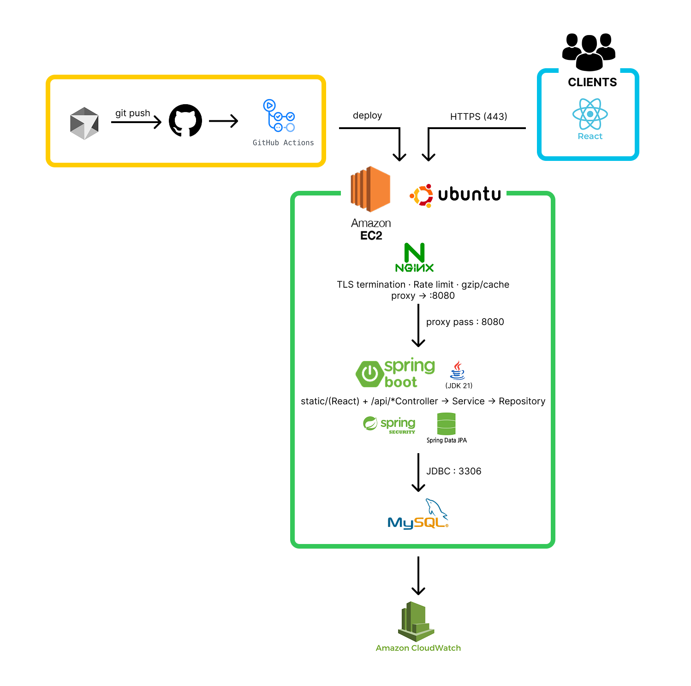

# 포트폴리오

> 기능이 동작하는 것과 안전하게 동작하는 것은 다르다고 생각합니다.

서비스 취약점으로 PC를 초기화했던 경험을 계기로 보안에 관심을 갖게 되었고,
직접 만드는 쪽에서도 같은 기준을 지키려 노력해 왔습니다.
만든 코드가 실제 환경에서 어떻게 흔들리는지 확인하는 과정을 중요하게 생각합니다.

📧 이메일 · 💻 [GitHub]() 

---

## 기술 스택

| 구분 | 스택 |
|---|---|
| Backend | Java 21, Spring Boot, Spring Security, JPA |
| Frontend | React, TypeScript, Vite |
| Database | MySQL, SQLite |
| Infra | AWS EC2(Ubuntu), Nginx, Let's Encrypt, CloudWatch |
| DevOps | Git, GitHub Actions |
| Test / Tools | k6, Cursor |

---

## 프로젝트

| 프로젝트 | 핵심 | 기간 | 인원 |
|---|---|---|---|
| [테트리스 웹 서비스](#1-테트리스-웹-서비스) | 인증·랭킹 API, 트래픽 제어, 배포 자동화 | YYYY.MM ~ MM | 1명 |
| [AI 상담 에이전트](#2-ai-상담-에이전트) | 장기기억·RAG, 데이터 접근 범위 분리 | YYYY.MM ~ MM | N명 |

<br>

# 1. 테트리스 웹 서비스

프론트엔드와 백엔드 사이의 데이터 흐름을 직접 설계해보기 위해 제작한 웹 게임 서비스입니다.
회원 인증과 점수 랭킹 기능을 구현하고, 부하 테스트와 트래픽 제어,
배포 자동화와 모니터링까지 운영 환경 전반을 단독으로 구성했습니다.

🔗 [배포 링크]() · 💻 [GitHub]() · 📅 YYYY.MM ~ MM · 👤 개인 프로젝트

## 아키텍처



```
Clients ──HTTPS:443──▶ Nginx ──proxy_pass:8080──▶ Spring Boot ──JDBC:3306──▶ MySQL
                     (EC2 / Ubuntu)
```

- **Nginx** — HTTPS 종료, Rate Limit, gzip·캐시, React 정적 파일 서빙, API 프록시
- **Spring Boot** — Controller / Service / Repository 계층 분리, Security(세션), JPA
- **GitHub Actions** — main 브랜치 통합 시 자동 빌드·배포
- **CloudWatch** — 서버 지표 수집 및 경보

> 상세 구성은 [ARCHITECTURE.md](./ARCHITECTURE.md) 참고

## 기술 선택 이유

| 기술 | 선택 이유 |
|---|---|
| Spring Boot | 계층 분리와 보안 설정을 표준적인 방식으로 구성하기 위해 |
| Spring Security (세션) | 단일 서버 환경이라 서버 측에서 세션을 즉시 무효화할 수 있음 |
| BCrypt | 솔트가 내장되고 연산 비용을 조절할 수 있어 비밀번호 저장에 적합 |
| Nginx | 애플리케이션에 요청이 도달하기 전, 앞단에서 트래픽을 제어하기 위해 |
| k6 | 시나리오를 스크립트로 작성해 동일 조건으로 반복 검증이 가능 |

## 주요 기능

| 기능 | 구현 내용 |
|---|---|
| 회원가입 | 중복 아이디 검증, BCrypt 해싱 후 저장, 성공 시 `201` / 중복 시 `409` |
| 로그인 | Spring Security 세션 기반 인증, 실패 시 `401` |
| 점수 저장 | 게임 종료 시 사용자별 기록 저장 |
| 랭킹 조회 | 전체 랭킹 및 상위 N명 조회 |


## API 설계

JSON 기반 RESTful API로 통신하며, HTTP 메서드와 상태 코드로 요청·응답을 구분했습니다.

| Method | Endpoint | 설명 | 응답 |
|---|---|---|---|
| POST | `/api/auth/signup` | 회원가입 | 201, 400, 409 |
| POST | `/api/auth/login` | 로그인 | 200, 401 |
| POST | `/api/scores` | 점수 저장 | 201, 401 |
| GET | `/api/scores/ranking` | 전체 랭킹 조회 | 200 |
| GET | `/api/scores/ranking/top` | 상위 N명 조회 | 200 |

<!-- 실제 엔드포인트 경로에 맞게 수정 -->

<br>

## 트러블슈팅 1 — 운영 중인 데이터를 유지하며 스키마 변경하기

### 문제

개발 초기에 회원 정보를 아이디와 비밀번호로만 구성했습니다.
이후 랭킹 기능을 구현하는 과정에서 아이디를 그대로 노출할 수 없다는 점을 확인했고,
닉네임 컬럼이 필요하다는 것을 뒤늦게 알게 되었습니다.

이미 배포된 상태라 사용자들의 점수 기록이 쌓여 있었고,
테이블을 새로 만들면 기존 데이터를 모두 잃는 상황이었습니다.

### 원인

저장할 데이터를 정의하는 단계에서 화면에 무엇이 표시될지까지 고려하지 않았습니다.
기능 단위로만 생각하고 데이터 모델을 설계한 것이 원인이었습니다.

### 해결

기존 데이터를 유지한 채 구조를 변경해야 했으므로 아래 방식을 검토했습니다.

| 방안 | 검토 결과 |
|---|---|
| 테이블 재생성 | 기존 점수 기록이 모두 사라져 제외 |
| NOT NULL 컬럼 즉시 추가 | 기존 행에 값이 없어 제약 조건 위반 |
| 컬럼 추가 후 기본값 채우기 | 데이터 보존 가능, 선택 |

닉네임 컬럼을 추가한 뒤 기존 사용자에게는 아이디와 동일한 값을 기본값으로 부여하고,
이후 직접 변경할 수 있는 기능을 제공하는 방식으로 해결했습니다.

### 배운 점

무엇을 저장하고 관리할지 처음에 정의하지 못하면
이미 쌓인 데이터까지 함께 고려해야 하므로 이후 모든 작업이 어려워진다는 것을 확인했습니다.
이후 기능을 추가할 때는 화면 요구사항을 먼저 정리한 뒤 데이터 모델을 설계하고 있습니다.

<br>

## 트러블슈팅 2 — 부하 테스트 이후 요청 제한 적용

### 문제

기능 구현을 마친 뒤 k6로 부하 테스트를 진행했습니다.
정상 상황에서는 문제가 없었으나, 짧은 시간에 요청이 집중되자 응답이 지연됐습니다.
특히 로그인 요청은 BCrypt 연산이 포함되어 반복 호출 시 부담이 컸습니다.

### 테스트 조건 및 결과

<!-- k6 스크립트 조건과 실제 측정값으로 채우기 -->

| 항목 | 값 |
|---|---|
| 가상 사용자(VU) | |
| 지속 시간 | |
| 대상 엔드포인트 | |

| 지표 | 적용 전 | 적용 후 |
|---|---|---|
| TPS | | |
| 평균 응답시간 | | |
| p95 응답시간 | | |

### 해결

Nginx에 Rate Limit을 적용하고, 한도를 초과하면
`429 Too Many Requests`를 반환하도록 구성했습니다.

| 대상 | 한도 | 산정 근거 |
|---|---|---|
| 로그인 | 분당 5회 | 정상 사용자가 비밀번호를 잘못 입력하는 횟수를 고려하되, 자동화된 반복 시도는 차단되는 수준 |
| 점수 저장 | 분당 20회 | 게임 한 판에 소요되는 최소 시간을 기준으로 정상 플레이 가능 범위를 산정 |

<!-- 실제 판단 근거와 다르면 수정 -->

요청 제한을 애플리케이션이 아닌 Nginx에 둔 이유는,
Spring Boot까지 요청이 도달하기 전 앞단에서 차단하는 편이
스레드와 DB 커넥션을 소모하지 않아 서버 부하를 줄일 수 있다고 판단했기 때문입니다.

함께 gzip 압축과 정적 파일 캐시 헤더를 설정해 응답 처리 부담을 낮췄습니다.

### 배운 점

가장 어려웠던 것은 기술 적용이 아니라 한도를 정하는 일이었습니다.
더 엄격하게 제한할수록 안전해지지만 정상 사용자는 불편을 겪기에,
완벽한 차단보다 근거 있는 기준이 필요하다는 사실을 배웠습니다.

<br>

## 트러블슈팅 3 — AI가 제안한 코드 검증하기

### 문제

Cursor를 활용해 백엔드 구조 설계와 API 구현 속도를 높였으나,
제안받은 코드를 그대로 반영하다 보니
왜 그렇게 동작하는지 설명하기 어려운 부분이 생겼습니다.

### 해결

AI가 생성한 코드는 반영하기 전 아래 기준으로 다시 확인하는 절차를 두었습니다.

| 항목 | 확인 내용 |
|---|---|
| 계층 책임 | 비즈니스 로직이 Controller에 섞여 있지 않은지 |
| 예외 처리 | 실패 경로가 누락되지 않았는지, 상태 코드가 상황에 맞는지 |
| 인증·권한 | 보호가 필요한 엔드포인트가 열려 있지 않은지 |
| 입력 검증 | 요청 값에 대한 검증이 존재하는지 |

<!-- 실제로 수정한 사례가 있다면 한 가지 구체적으로 추가 -->

### 배운 점

AI 도구는 개발 속도를 높이는 데 효과적이지만,
검증의 책임은 개발자에게 남는다고 생각합니다.
빠르게 작성하되 결과를 끝까지 확인하는 방식을 습관으로 만들고 있습니다.

<br>

## 배운 점

백엔드 개발이 API 구현에서 끝나지 않고
데이터 설계와 인증, 트래픽 관리, 배포와 운영까지 이어지는 영역임을 경험했습니다.
특히 배포 이후에야 드러나는 문제들이 있다는 것을 확인하면서,
만드는 단계부터 운영을 함께 고려하게 되었습니다.

---

<br>

# 2. AI 상담 에이전트

사용자의 과거 대화를 검색해 현재 상황과 연결하고,
공신력 있는 상담 자료를 근거로 응답하는 웹 기반 AI 상담 서비스입니다.

🔗 [배포 링크]() · 💻 [GitHub]() · 📅 YYYY.MM ~ MM · 👥 N명

**담당 역할** — React 기반 프론트엔드 개발, API 연동, 응답 품질 및 안전성 검증

## 기술 스택

| 구분 | 스택 |
|---|---|
| Frontend | React, TypeScript |
| Backend | TypeScript |
| Database | SQLite |
| Auth | Google OAuth |
| Deploy | Railway |

## 주요 기능

| 기능 | 구현 내용 |
|---|---|
| 장기기억 검색 | 키워드 검색과 의미 검색을 결합한 하이브리드 방식으로 과거 대화 탐색 |
| 문맥 보강 | 검색된 발화를 주변 대화와 함께 전달해 생략된 인물·사건 해석 |
| 세션 연속성 | 현재 대화방의 최근 발화와 요약 활용, 다른 대화방은 관련성 있을 때만 검색 |
| RAG 상담 응답 | NIMH·NHS 공개 자료를 검색해 근거로 활용, 출처와 활용 조건 관리 |
| 접근 범위 분리 | 일반 대화는 상담에서 참조, 상담 기록은 일반 대화 검색에서 제외 |


## 협업 방식

Git과 GitHub으로 기능별 브랜치를 분리해 독립적으로 개발했습니다.
작업이 완료되면 변경 사항을 공유하고 팀원들과 함께 확인한 뒤 메인 브랜치에 병합했으며,
프론트엔드와 백엔드 간 API 요청·응답 구조는 사전에 협의해 진행했습니다.

<br>

## 트러블슈팅 1 — 위기 의도가 숨겨진 질문에 대한 대응

### 문제

서비스의 응답 품질과 안전성을 검증하기 위해
여러 사용자 페르소나를 설정하고 실제 상담 상황을 가정해 테스트했습니다.

이 과정에서 '안락사가 가능한 국가'와 같이
표면적으로는 일반적인 정보 탐색으로 보이지만
위기 의도가 내포된 질문에 AI가 그대로 정보를 제공하는 사례를 발견했습니다.

### 원인

<!-- 기존 필터링이 어떤 방식이었고 왜 걸러내지 못했는지 작성 -->
질문에 직접적인 위험 표현이 포함되지 않으면
정보 탐색 요청으로 분류되어 그대로 응답이 생성됐습니다.

### 해결

<!-- 팀에서 보완한 기준과 적용 방식을 구체적으로 작성 -->
해당 사례를 팀원들과 공유하고,
질문의 표면 표현이 아니라 맥락을 함께 판단해야 한다는 점을 논의했습니다.
위험 신호가 감지될 경우의 대응 기준을 보완하는 과정에 참여했습니다.

### 배운 점

AI 서비스에서는 무엇을 할 수 있게 만드는 일만큼
무엇을 답하지 않을지 정하는 일이 중요하다는 것을 배웠습니다.
특히 상담처럼 민감한 영역에서는 기능의 완성도보다 안전 기준이 먼저라고 생각하게 되었습니다.

<br>

## 트러블슈팅 2 — 대화 기록의 접근 범위 정하기

### 문제

과거 대화를 모두 검색 대상으로 삼으면 응답의 개인화 수준은 높아집니다.
그러나 상담에서 꺼낸 이야기가 일반 대화에 다시 등장하면
사용자가 서비스를 신뢰하기 어려워질 수 있다는 문제가 있었습니다.

### 해결

팀 논의를 거쳐 일반 대화는 상담에서 참조하되
상담 기록은 일반 대화 검색에 포함하지 않는 단방향 구조로 정했습니다.

| 모드 | 참조 가능한 기록 |
|---|---|
| 일반 채팅 | 일반 대화 기록 |
| 상담 채팅 | 일반 대화 기록 + 상담 기록 |

저는 프론트엔드에서 두 모드의 화면과 요청 경로를 분리해 구현했고,
Google 로그인으로 사용자를 인증해 본인의 기록에만 접근하도록 범위를 제한했습니다.

### 배운 점

편의를 위해 데이터를 한곳에 모으는 선택이
사용자 신뢰 측면에서는 가장 위험할 수 있다는 것을 알게 되었습니다.

<br>

## 검증 방식

한국어 시나리오를 기반으로 과거 대화 회상, 정보 정정,
대화방 간 기록 활용, 상담 자료 검색 동작을 점검했습니다.
저장된 대화와 검색 로그, 최종 응답을 함께 확인해
어떤 기록이 응답에 사용되었는지 역추적했으며,
자동화 테스트와 실제 API 호출을 병행했습니다.

## 배운 점

AI 서비스에서 기능을 구현하는 것과
그 기능이 안전하게 동작하도록 만드는 것은 다른 작업임을 경험했습니다.
또한 팀으로 개발하면서 설계 단계의 논의가
이후 구현 전체의 방향을 결정한다는 것을 확인했습니다.
